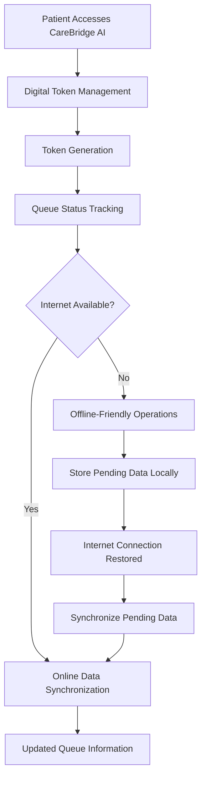

# 🌉 CareBridge AI
### Connecting Care. Empowering Communities. Improving Lives.

**An inclusive, AI-assisted healthcare coordination platform designed to make essential healthcare services more accessible, transparent, and reliable — especially for rural and underserved communities.**

<p align="center">

  🌐 **Live Website:** https://whycodehack.vercel.app/

  💻 **Repository:** https://github.com/swathi-dot4/whycodehack

</p>

---

## 💡 The Idea in One Minute

Healthcare access is not just about finding a hospital. For many people, especially those living in rural areas, accessing timely healthcare can involve long waiting times, limited internet connectivity, difficulty navigating hospital services, and a lack of clear information.

Even when patients reach a healthcare facility, managing queues, understanding their position, and knowing when their turn will arrive can become challenging.

**CareBridge AI** aims to simplify this journey through a connected digital healthcare experience.

Our current development focuses on two important challenges:

- **Digital Token Management (DTM):** Making hospital queues more transparent, organized, and easier to manage.
- **Offline Synchronization:** Helping healthcare workflows continue during internet interruptions and synchronizing pending information when connectivity returns.

Our broader vision is to combine accessible healthcare information, AI-assisted support, patient coordination, and connectivity-aware technology into one platform.

> Our guiding principle: Technology should reduce barriers between people and healthcare, not create new ones.

## 🚨 The Problem

| Challenge | Why It Matters |
|---|---|
| Long hospital waiting times | Patients spend unnecessary time waiting without clear queue information. |
| Manual token management | Traditional queue systems can create confusion and inefficiency. |
| Lack of transparency | Patients may not know their current token status or waiting position. |
| Rural healthcare accessibility | Reaching healthcare services can be difficult for underserved communities. |
| Unreliable internet connectivity | Online-only systems may become unavailable during network interruptions. |
| Fragmented patient information | Important healthcare information may be difficult to organize and access. |
| Medicine information gaps | Patients may struggle to understand medicine-related information. |

## 💡 Our Approach

CareBridge AI focuses on building a connected, patient-centered healthcare-support platform.

Instead of treating healthcare services as separate activities, our approach focuses on improving the overall patient journey — from accessing healthcare services to managing queues and maintaining continuity during connectivity interruptions.

### Key Solution Areas

| Capability | Intended Value |
|---|---|
| Digital Token Management (DTM) | Enables organized and transparent patient queue management. |
| Digital Queue Tracking | Helps patients understand their token status and waiting progress. |
| Offline Synchronization | Supports essential workflows during network interruptions and synchronization after reconnection. |
| Rural Healthcare Accessibility | Makes digital healthcare services easier to access and navigate. |
| Multilingual Support | Aims to reduce language barriers for diverse communities. |
| AI-Assisted Healthcare Support | Aims to make healthcare information easier to understand. |
| MediScan / Medicine Information | Supports access to understandable medicine-related information. |
| Appointment Coordination | Helps patients navigate appointments and healthcare services. |
| Referrals and Follow-ups | Supports continuity beyond an individual hospital visit. |

**Implementation transparency:** Digital Token Management and Offline Synchronization are central areas of our current development. Other solution areas represent the broader CareBridge AI vision and should be considered planned or in development unless they are available and demonstrable in the deployed application.

## ⭐ Core Features

### 1. Digital Token Management (DTM)

A digital approach to managing patient queues in healthcare facilities.

- Simplifies patient token management.
- Promotes transparency in queue handling.
- Helps patients track their token progress.
- Reduces confusion associated with manual queue systems.
- Supports a more organized hospital experience.

### 2. Offline Synchronization

Designed for communities and healthcare facilities where internet connectivity is unreliable.

- Supports offline-friendly application workflows.
- Maintains relevant information locally where supported.
- Helps reduce interruptions during network failures.
- Synchronizes pending information when connectivity is restored.
- Aims to improve continuity and reliability of digital healthcare services.

### 3. Patient-Centered Healthcare Experience

- Simple and accessible user interface.
- Easy navigation between healthcare services.
- Designed with rural users and digital accessibility in mind.
- Focuses on reducing complexity in healthcare interactions.

### 4. AI-Assisted Healthcare Vision

- Simplified access to healthcare-related information.
- Potential multilingual voice and text assistance.
- Structured patient information for professional review.
- Medicine information support through appropriate sources.

## 🔄 How It Is Intended to Work

The CareBridge AI journey is designed around the following workflow:

1. **Connect:** Patients access the CareBridge AI platform.
2. **Register:** Patients provide the required information through the available workflow.
3. **Generate Token:** A digital token is created through the token management process.
4. **Track:** Patients can view their token status and queue progress.
5. **Continue Offline:** Supported workflows can operate during internet interruptions.
6. **Synchronize:** Pending information is synchronized when internet connectivity returns.
7. **Access Care:** Patients can continue navigating relevant healthcare services.

### Digital Token and Offline Synchronization Workflow



## 🎯 Target Users

CareBridge AI is designed with the following users in mind:

- Rural and underserved communities.
- Patients visiting hospitals and healthcare centers.
- Primary Healthcare Centres (PHCs).
- Government hospitals.
- Healthcare administrators.
- Hospital staff and healthcare coordinators.

## 🌍 What Makes Our Approach Meaningful?

- **Patient-first:** Designed around real challenges faced by patients.
- **Inclusive:** Considers language, accessibility, and digital literacy.
- **Transparent:** Focuses on improving visibility into patient queue management.
- **Connectivity-aware:** Considers unreliable internet as a real-world design challenge.
- **Scalable:** Envisions supporting different healthcare facilities and communities.
- **Human-centered:** Uses technology to assist healthcare services rather than replace healthcare professionals.

## 🛠️ Technology Stack

The project uses a modern web development toolchain.

| Technology | Role |
|---|---|
| React | Component-based user interface |
| TypeScript | Type-safe application development |
| Vite | Development server and production build |
| Tailwind CSS | Responsive and modern styling |
| Lucide React | Interface icons |
| HTML5 | Application structure |
| CSS3 | Styling and responsive layouts |
| JavaScript | Application functionality |
| Vercel | Website deployment and hosting |

The technology list reflects the repository's declared dependencies and project configuration. Add any additional database, AI, or synchronization service only after verifying its actual integration.

## 🚀 Getting Started

### Prerequisites

- Node.js
- npm
- Git

### Run Locally

**1. Clone the repository**

```bash
git clone https://github.com/swathi-dot4/whycode4uhack.git
```

**2. Navigate to the project directory**

```bash
cd whycode4uhack
```

**3. Install dependencies**

```bash
npm install
```

**4. Start the development server**

```bash
npm run dev
```

Open the local URL displayed in your terminal.

### Production Build

To create a production build:

```bash
npm run build
```

To preview the production build locally:

```bash
npm run preview
```

## 🔐 Responsible AI, Safety, and Privacy

Healthcare is a high-trust domain. CareBridge AI follows a responsible development approach:

- Protect sensitive patient information.
- Collect only necessary information.
- Apply appropriate data protection practices.
- Clearly distinguish AI-generated information from verified medical records.
- Keep diagnosis and treatment decisions with qualified healthcare professionals.
- Use reliable sources for medicine-related information.
- Provide appropriate emergency guidance.
- Avoid presenting AI-generated responses as definitive medical conclusions.

**Disclaimer:** CareBridge AI is a healthcare-support initiative and is not a replacement for professional medical advice, diagnosis, treatment, or emergency services.

## 🌱 Social Impact and UN Sustainable Development Goals

CareBridge AI aims to contribute to the following Sustainable Development Goals:

| SDG | Contribution |
|---|---|
| SDG 3 – Good Health and Well-being | Supporting accessible and coordinated healthcare services. |
| SDG 9 – Industry, Innovation and Infrastructure | Applying digital innovation to improve healthcare infrastructure. |
| SDG 10 – Reduced Inequalities | Addressing accessibility barriers faced by underserved communities. |

Our goal is to make technology useful for people who need accessible healthcare the most.

## 🗺️ Roadmap

Our development journey includes the following priorities:

- [x] Establish the CareBridge AI web application.
- [x] Develop the initial user interface.
- [x] Begin Digital Token Management development.
- [x] Develop offline synchronization workflows.
- [ ] Improve digital queue transparency and tracking.
- [ ] Strengthen offline data reliability and synchronization.
- [ ] Expand multilingual accessibility.
- [ ] Enhance AI-assisted healthcare support.
- [ ] Integrate verified healthcare information sources.
- [ ] Conduct usability testing with target users.
- [ ] Improve security, privacy, and accessibility.
- [ ] Expand support for healthcare facilities.

*The checklist represents development progress and priorities; individual features should be validated against the latest deployed build.*

## 🏆 For Hackathon Evaluation

We want CareBridge AI to demonstrate how technology can address real-world healthcare challenges.

The following materials will help evaluators understand the project:

1. Live website demonstration.
2. Screenshots of the actual application.
3. Digital Token Management demonstration.
4. Offline operation and synchronization demonstration.
5. System architecture and workflow explanation.
6. Technology stack and implementation details.
7. Future scope and expected social impact.

### Suggested Demo Flow

**Problem → Proposed Solution → Digital Token Management → Offline Synchronization → Technical Architecture → Social Impact → Future Scope**

## 👩‍💻 Team

**Project:** CareBridge AI

**Hackathon:** WhyCode Hackathon

**Repository:** [whycode4uhack](https://github.com/swathi-dot4/whycodehack)

We are a team of passionate developers working towards making healthcare more accessible, transparent, and reliable through technology.

*Add the names, roles, and contributions of all team members before final submission.*

## 🌉 CareBridge AI

### Bridging the Gap Between People Who Need Care and the People Who Provide It.

**Built with purpose. Designed for access. Guided by empathy.**

*Connecting Care. Empowering Communities. Improving Lives.*
